# Assignment #4: Forms and Validation

**Name:** Avirup Roy

**Group:** IT-2513

**Live Site:** https://aviruproyneal.github.io/assignment4_webtech/

---

## Part 1: Basic HTML Forms

### Task 0: Simple Contact Form

I created a basic contact form with Name, Email, Message, and a Submit button. Every field has a proper `<label>` connected to the input using the `for` attribute, so clicking the label focuses the field.

**Screenshot:**

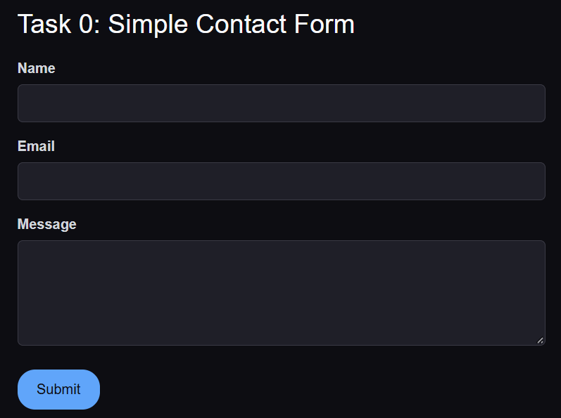
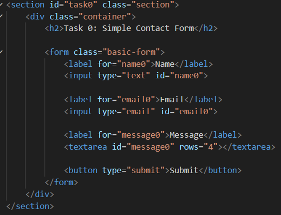

### Task 1: HTML5 Validation

I added built-in HTML5 validation attributes to the same form:

- `required` on all fields
- `minlength` and `maxlength` on the name field
- `maxlength` on the textarea
- `type="email"` so the browser checks email format

When I try to submit with empty fields or an invalid email, the browser shows its own error messages without any custom code.

**Screenshot:**

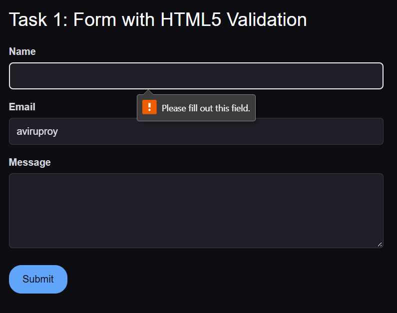
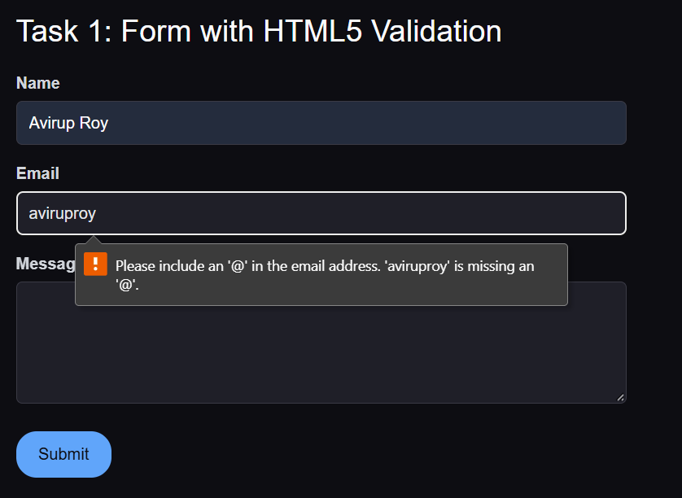
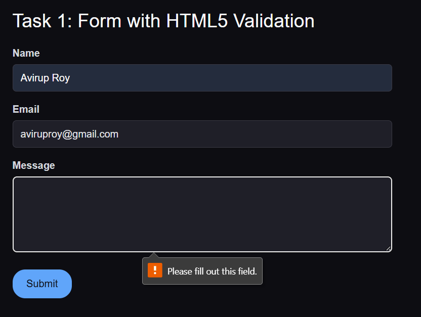
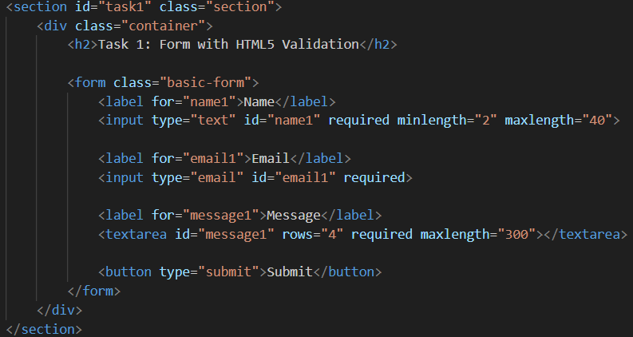
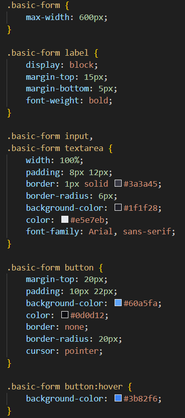
---

## Part 2: Bootstrap Forms

### Task 2: Form Styling using Bootstrap

I rebuilt the same contact form using Bootstrap's form classes. The layout uses the Bootstrap grid with `row` and `col-md-6`, so the Name and Email sit side-by-side on tablet/desktop and stack on mobile. I used `form-control` for inputs, `form-label` for labels, `form-text` for helper text, and placeholders on every field.

**Screenshot:**

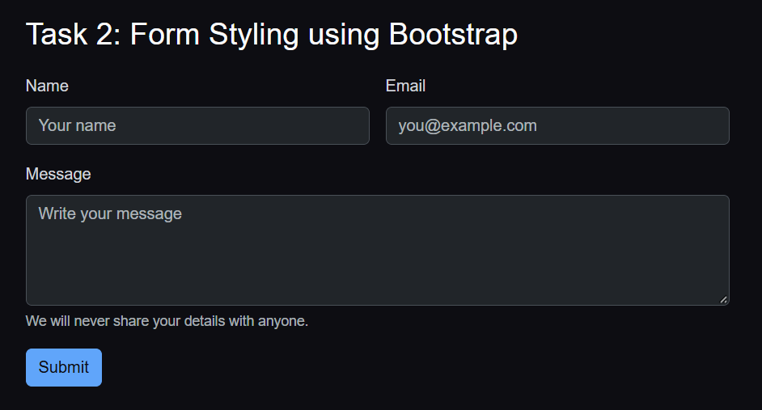
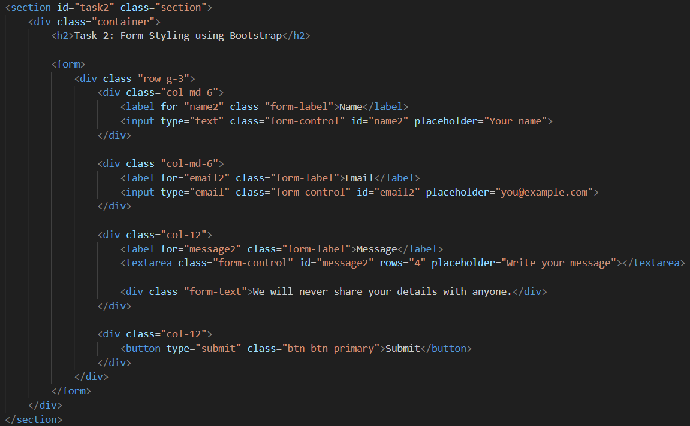

### Task 3: Bootstrap Validation Styles

I applied Bootstrap's validation feedback classes to the form. Each input has an `invalid-feedback` div (red error message) and a `valid-feedback` div (green success message). A small script toggles the `is-invalid` and `is-valid` classes on each field as the user types, so empty fields turn red and correctly filled fields turn green.

**Screenshot (invalid state):**

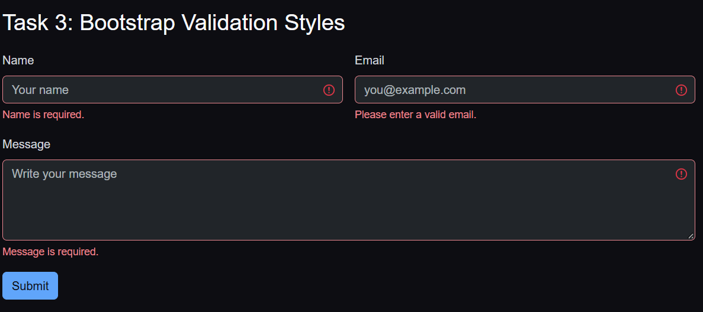

**Screenshot (valid state):**

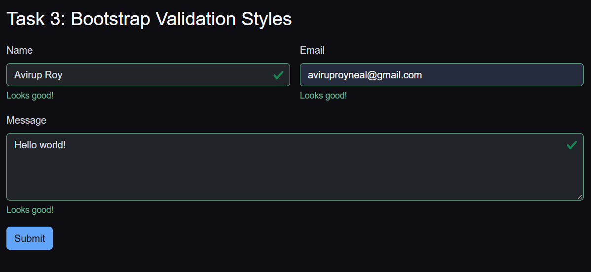

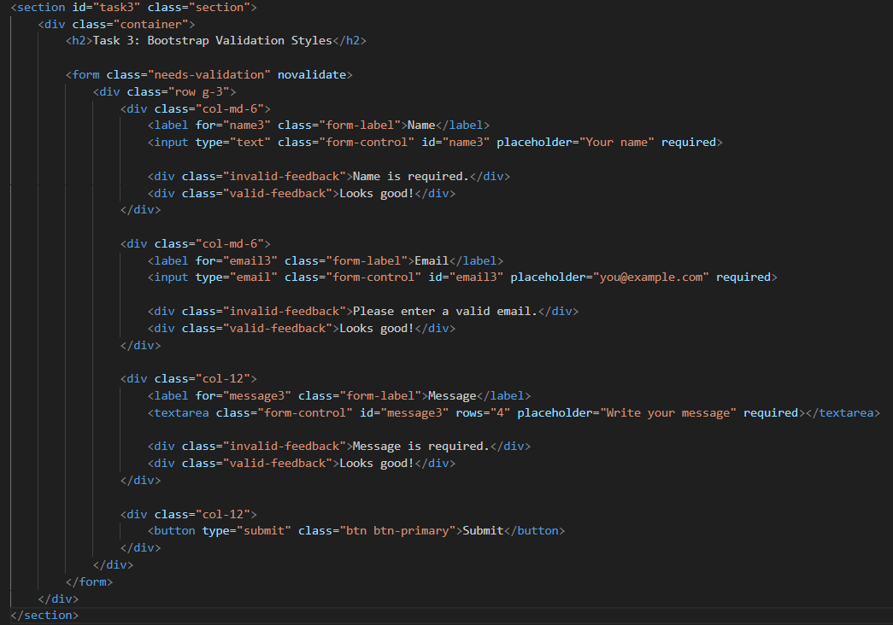
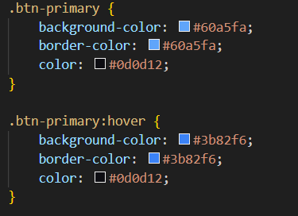

---

## Part 3: Advanced Form Project

### Task 4: Registration Form

I built a full registration form with:

- First Name, Last Name (side-by-side on desktop)
- Email
- Password must be at least 8 characters
- Confirm Password with `minlength="8"`
- Gender radio buttons (Male, Female, Other)
- Hobbies checkboxes (Reading, Gym, Travel)
- Country dropdown
- Register (submit) and Reset buttons

The whole form uses the Bootstrap grid (`row`, `col-md-6`, `col-12`) so it stays responsive. HTML5 validation and Bootstrap feedback are applied to every field.

**Screenshot:**

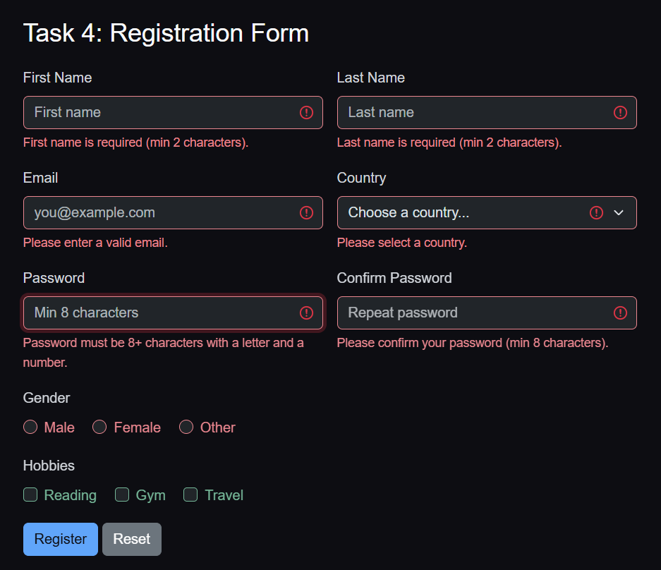

**Screenshot (validation):**

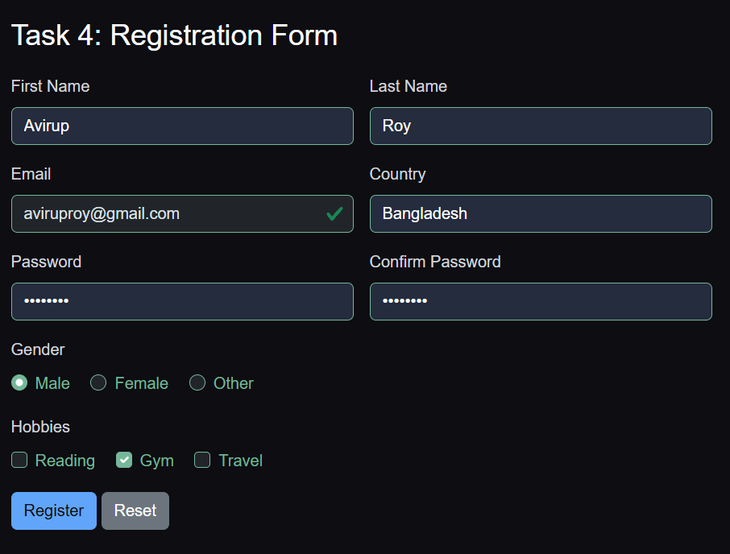

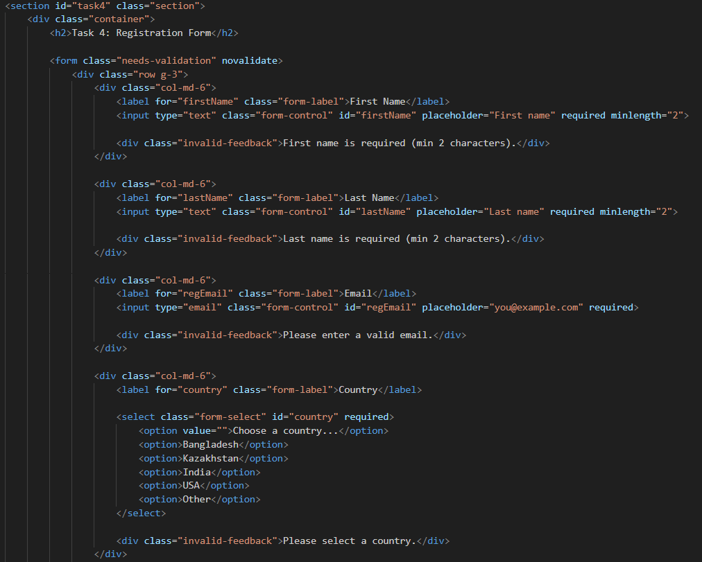
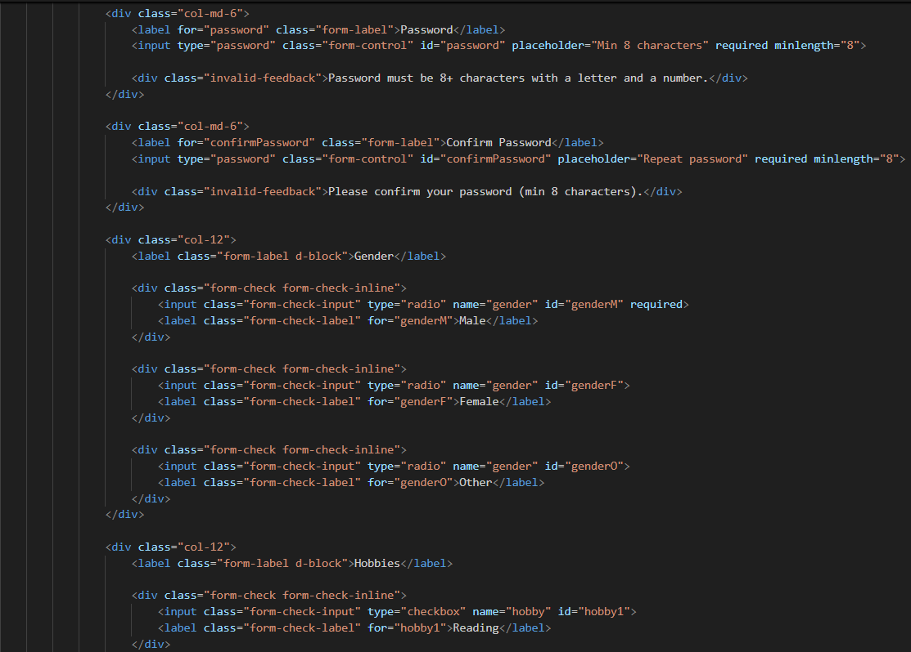
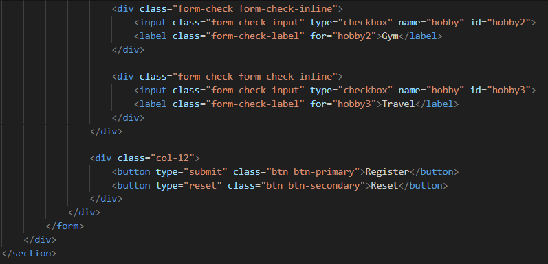
---

## Summary

The main thing I learned here was the difference between HTML5 validation and Bootstrap validation. HTML5 validation is built into the browser attributes like `required`, `minlength`, and `type="email"` trigger native error pop-ups. Bootstrap validation is more visual with classes like `is-invalid` and `is-valid` to color the borders and show inline feedback messages.

For Bootstrap validation to work properly, the form needs `novalidate` on the form tag so the browser doesn't show its own pop-up. That way Bootstrap's styling takes over. A small script toggles the `is-valid` and `is-invalid` classes on each field as the user types, so the feedback feels responsive.

---
